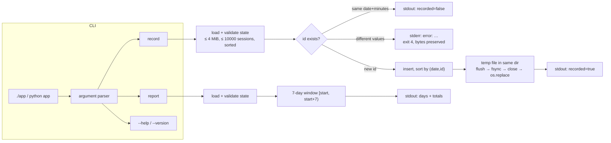
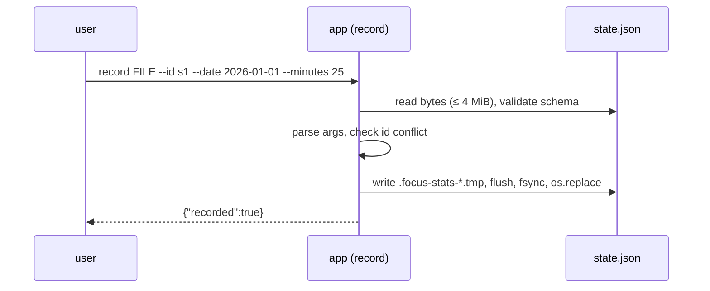

# offline-focus-stats

Deterministic focus-session recording and weekly reporting from the command line.
Sessions are written to a small UTF-8 JSON file; the weekly report is a pure
function of that file and the requested week.

- Product version: **0.1.0** · Spec version: **0.1.4** (issue #88, original idea
  "Pomodoro Timer with Deep Work Stats", analytical subset)
- Platform: **POSIX** — Ubuntu and macOS (CI: `ubuntu-latest`, `macos-latest`)
- Runtime: **Python 3.12**, standard library only, fully offline
- Native Windows is explicitly out of scope for this version

## Problem and scope

Tracking deep work usually means a stopwatch, a wall clock, notifications and a
desktop UI. `offline-focus-stats` keeps only the part that can be checked
mechanically: you write down the focus sessions you already completed, and the
tool stores them durably and aggregates them into a seven-day window.

In scope:

- `record` — insert one session (`id`, `date`, `minutes`) into a JSON state file.
- `report` — print seven per-day totals plus week totals for an arbitrary
  seven-day window.

Out of scope: menu bar, running timer, wall-clock or system time, PDF export,
external calendar sync, XP/percentages, notification daemon, concurrent
writers, native Windows.

## Quickstart

Requires Python 3.12; no installation. Run from the repository root in a
POSIX shell. The new checked-in `fixtures/focus.json` is an empty state;
copying it resets only the disposable `focus-example.json`. The same
session is idempotent; changing its minutes is a conflict (exit 4).

```console
$ cp fixtures/focus.json focus-example.json
$ python app record focus-example.json --id s1 --date 2026-01-01 --minutes 25
{"recorded":true}
$ python app record focus-example.json --id s1 --date 2026-01-01 --minutes 25
{"recorded":false}
$ python app report focus-example.json --week-start 2026-01-01
{"start":"2026-01-01","days":[{"date":"2026-01-01","sessions":1,"minutes":25},{"date":"2026-01-02","sessions":0,"minutes":0},{"date":"2026-01-03","sessions":0,"minutes":0},{"date":"2026-01-04","sessions":0,"minutes":0},{"date":"2026-01-05","sessions":0,"minutes":0},{"date":"2026-01-06","sessions":0,"minutes":0},{"date":"2026-01-07","sessions":0,"minutes":0}],"sessions":1,"minutes":25}
$ python app record focus-example.json --id s1 --date 2026-01-01 --minutes 50
error: session id 's1' already exists with a different date or minutes
$ echo $?
4
```

## CLI reference

```
app record FILE --id ID --date YYYY-MM-DD --minutes N
app report FILE --week-start YYYY-MM-DD
```

| Option | Meaning |
| --- | --- |
| `FILE` | path of the JSON state file (positional, required) |
| `--id ID` | session identifier, ASCII `[A-Za-z0-9_-]{1,32}` |
| `--date YYYY-MM-DD` | strict Gregorian date, `0001-01-01`..`9999-12-31` |
| `--minutes N` | focus minutes, strict integer `1`..`480` (leading zeros allowed) |
| `--week-start YYYY-MM-DD` | first day of the seven-day window, at most `9999-12-25` |
| `--help`, `--version` | top-level informational options |

Options and `FILE` may appear in any order, keeping each flag/value pair together.

### Output

- `record`, new id → `{"recorded":true}` and one LF
- `record`, id already present with the same date and minutes → `{"recorded":false}`
- `report` → one JSON line:

```json
{"start":"2026-01-01","days":[{"date":"2026-01-01","sessions":1,"minutes":25}],"sessions":1,"minutes":25}
```

`days` always contains exactly seven objects in chronological order, zero-filled
on empty days. Totals are exact integer sums of those seven days.

### Exit codes

| Code | Meaning |
| --- | --- |
| `0` | success |
| `2` | invalid argument, unknown/missing option, too many sessions for a new insert |
| `3` | I/O failure, missing state for `report`, corrupt state |
| `4` | session id already recorded with a different date or minutes |

On any error stdout is empty and stderr holds a single line starting with
`error:` and no traceback.

## State file

```json
{"sessions":[{"id":"s1","date":"2026-01-01","minutes":25}]}
```

Normative constraints (checked on every read; violations exit `3` without
overwriting the file):

- top level is an object whose only key is `sessions`, an array;
- each session has exactly `id`, `date`, `minutes`;
- ids are unique and match `[A-Za-z0-9_-]{1,32}`;
- dates are real Gregorian `YYYY-MM-DD` strings;
- `minutes` is a strict integer `1..480` (`25.0`, `true`, `null` are invalid);
- at most **10000** sessions and at most **4 MiB** (`4194304` bytes);
- sessions sorted ascending by `(date, id)`;
- UTF-8 without BOM; duplicate JSON keys, `NaN`, `Infinity` and extra fields are
  invalid; a zero-byte file is corrupt (the only empty state is `{"sessions":[]}`).

`record` creates a missing file when its parent directory exists and rewrites the
file atomically: a temporary file in the same directory, `flush`, `fsync`,
`close`, `os.replace`. A failure before the replacement leaves the original bytes
untouched, removes the temporary file when possible and exits `3`. The
destination is never opened in truncation mode. `report` is strictly read-only.

## Manifest

There is no runtime dependency and therefore no `setup`, no `pyproject.toml`
packaging and no `requirements.txt`: the runtime manifest is "Python 3.12
standard library only". Development tooling (linter, formatter, test runner) is
pinned in [`requirements-dev.txt`](requirements-dev.txt) and installed only
during preparation — never during a test run.

## How to run the checks

```console
python -m pip install -r requirements-dev.txt   # preparation step only
ruff format --check .
ruff check .
python -m pytest
```

Tests run the product as a subprocess through `sys.executable`, use an isolated
directory per test and never import implementation modules. They are traceable
to the acceptance criteria `AC-1` … `AC-14` in the test names and docstrings.

CI (`.github/workflows/ci.yml`) runs lint, format check and tests on
`ubuntu-latest` and `macos-latest` with Python 3.12 and `PYTHONUTF8=1`.
A green CI run on the declared targets is the completion gate; a local Linux
result does not prove macOS.

## Architecture





## Design decisions

1. **No clock, no timer.** Sessions are facts supplied by the user; the tool
   never reads the system time, so runs are reproducible and testable offline.
2. **JSON state, not SQLite.** The dataset is bounded (10000 sessions, 4 MiB), so
   a single-document file with atomic replacement is simpler and keeps the
   runtime dependency-free.
3. **Strict validation on read, before any mutation.** Corrupt state is a hard
   error (`3`) rather than something to repair; a tool that silently rewrites
   damaged user data is worse than one that refuses.
4. **Idempotent record.** Repeating an identical `record` returns
   `{"recorded":false}`, so retries after an interruption are safe.
5. **Arbitrary seven-day window.** `--week-start` is inclusive at the start and
   exclusive at start+7 and need not be a Monday, which keeps the aggregation a
   pure slice of time rather than a calendar-policy decision.
6. **Argument validation before I/O.** Invalid arguments exit `2` even when the
   state file is missing or corrupt, so mistakes are reported deterministically.
7. **POSIX-only surface.** Windows-specific launchers are deliberately absent;
   adding them is a separate, testable increment.

## How this was built

This is a staged delivery. Spec, implementation and tests are distinct artifacts.

- **Spec** — `88 — offline-focus-stats`, spec v0.1.4, product v0.1.0, supplied as
  GitHub issue #1 by the maintainer. It is not stored as a separate file in this
  repository, so no spec hash is recorded here.
- **Implementation** — `app` + `focus_stats.py`, written by an AI agent running
  in the Claude Code harness. Requested/observed model as reported by the
  harness: `deepseek-flash`. No human authorship is claimed.
- **Public tests** — `tests/`, written by the same agent run, traceable to
  `AC-1`…`AC-14`. They are black-box: subprocess CLI only, no imports of
  implementation modules.
- **Independent hidden tests** — authored by another model family from the spec
  alone, external to this clone. Their results are not known at the time of this
  commit and are therefore not reported here.
- **Human participation and corrections** — recorded by the maintainer, not by
  the agent.

Run record for the v0.1.0 implementation run:

| Field | Value |
| --- | --- |
| Issue / run id | #1 |
| Spec version | v0.1.4 (hash: not recorded, spec delivered in the issue body) |
| Judge / hidden-test hash | not recorded (external to the clone) |
| Stage | implementation + public tests |
| Requested model | not recorded (`null`) |
| Observed model | `deepseek-flash` (harness-reported) |
| Tokens / cost | not recorded by the agent (`null`) |
| Turns / correction rounds | not recorded by the agent (`null`) |
| Stop reason | task completion (agent) |
| Human interventions | recorded by the maintainer, not by the agent |
| Verdicts | local Linux checks green; CI verdict pending the maintainer's push |

## License

MIT, 2026 — see [LICENSE](LICENSE).
